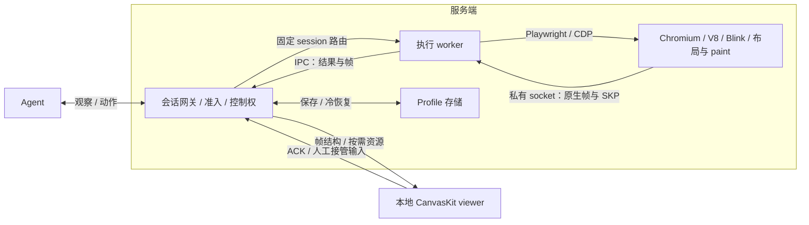
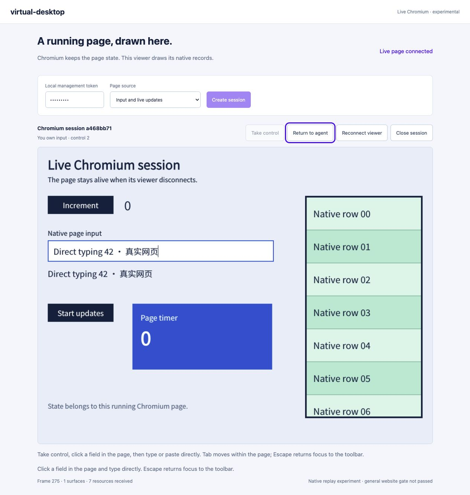
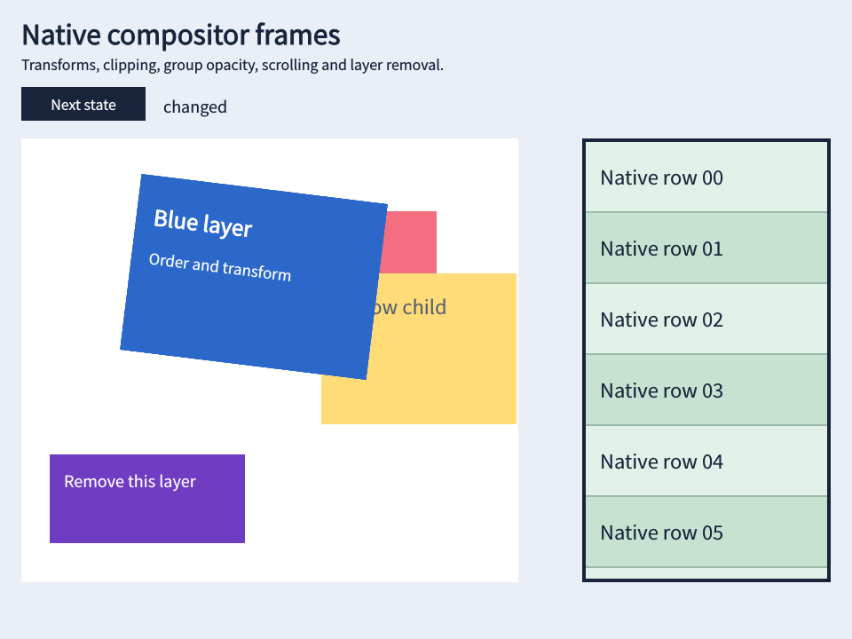
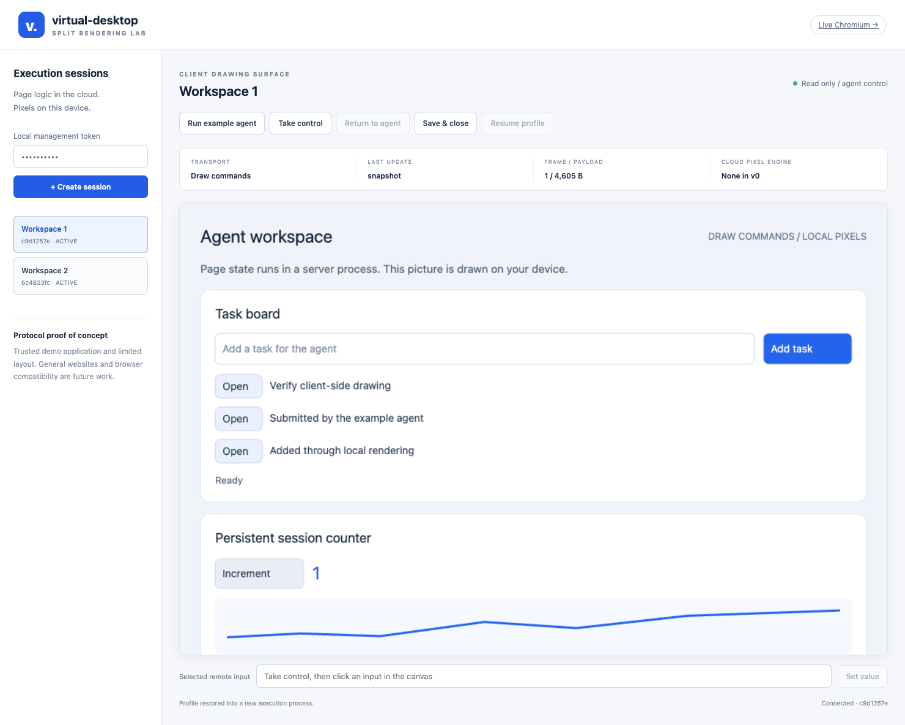

# virtual-desktop

面向 agent 的网页运行时：**云端执行网页，本地生成画面，以会话为单位调度。**

## Motivation

长期运行的 agent 需要独立身份、持续的网页状态，以及随时让用户接管的能力。对于以网页为主的任务，我们希望把这些能力组织成可调度的浏览器会话，按需分配执行资源和显示连接，减少对完整桌面环境的依赖。

核心思路是拆开三个生命周期：**profile 保存身份，session 承载执行，viewer 负责显示。** 用户查看或切换画面不需要重建执行环境；后台语义操作不依赖 viewer 在线；最终像素绘制交给客户端。目标是在保持网页语义与交互正确性的前提下，降低云端图形开销，并提高网页任务的资源复用程度。

VM 仍可作为底层安全隔离边界，本运行时也可以部署在 VM 内。项目聚焦网页执行与显示，不覆盖通用桌面应用和完整操作系统环境。

## 核心实现与整体结构



- **云端保留真实网页执行。** 自编译 Chromium 156 保留网络、V8、DOM/CSS、布局与 paint，从原生活跃图层树导出完整帧和 Skia Picture（SKP）绘图记录；实验路径阻止 picture-layer tile raster，并通过 headless Viz / NullRenderer 跳过最终绘制。
- **客户端生成像素。** 匹配版本的 CanvasKit 重放 SKP，处理层序、变换、裁剪和透明度。资源按哈希复用，帧通过 ACK 和有界背压传输；客户端不执行来源网页脚本来重建页面。
- **agent 与人工共用状态。** 语义操作和接管输入进入同一页面；control epoch 撤销旧控制者，actionId 去重，坐标输入绑定已显示帧。切换控制权或 viewer 不迁移 JS heap。

当前接入网关的是每会话独立 worker/browser；共享 browser host 仍是独立原型。实现细节见 [引擎切分](docs/CHROMIUM_ENGINE.md)、[完整帧](docs/CHROMIUM_FRAMES.md)与[持续会话](docs/CHROMIUM_LIVE.md)。

## 多用户、多并发如何调度

目标映射为 `用户/租户 → profile → session → host → BrowserContext/renderer`。**当前已实现单机会话调度，尚未实现生产租户层与跨节点调度。**

| 环节 | 当前机制 |
| --- | --- |
| 准入 | 限制活跃会话、等待队列和同时启动数；FIFO 排队、超时失败、超限返回 429；同一 profile 只允许一个写入会话。原生 CLI 默认 1 个活跃会话、1 个启动任务 |
| 执行 | 会话固定绑定执行 owner；会话间可并行，同会话动作串行且队列有界，避免并发输入破坏页面状态 |
| 显示与接管 | viewer 与执行分离；热切换只改订阅和控制权。慢 viewer 合并中间帧，不让显示历史无限堆积；无 viewer 时语义 agent 可继续执行 |
| 回收与恢复 | 显式保存 cookies/localStorage 后释放执行进程，之后新建会话冷恢复；故障释放准入槽。当前不保存 JS heap/DOM，也没有自动闲置驱逐 |

**共享 host 原型：**一个 browser 承载多个独立 BrowserContext/renderer，按 lease 与 renderer 路由帧，保留各自存储、输入和资源边界。已验证两个可信会话并行、单 context 回收和 renderer 故障范围；browser 崩溃仍影响该 host 的所有会话。[实测与边界](docs/CHROMIUM_POOL.md)

**扩容设计（待实现）：**按信任域和引擎版本拆分有界 host 池，依据 CPU、内存、启动压力和租户配额放置新 session；优先复用有余量的预热 host，满时排队或扩容。维护固定 owner 路由，达到资源/寿命阈值后排空回收；租户加权公平队列与跨节点放置需要另行实现。BrowserContext 隔离网页状态，不能替代不可信用户之间的 VM/sandbox 隔离。

## 与 Muse、Dots、Grok Bot、Manus 的 VM 路线比较

以下按公开资料比较执行环境与分配粒度，核对日期为 2026-10-29；不推断厂商未公开的底层调度实现。

| 方案 | 公开的执行环境 | 并发与状态组织 |
| --- | --- | --- |
| [Meta Muse](https://research.meta.ai/blog/security-and-safety-for-ai-agents-our-approach-with-muse) | 用户专属 Linux VM，包含浏览器、文件与工具 | VM 保存用户数据，支持并发 sub-agent 和定时任务 |
| [OpenAI Dots](https://learn.chatgpt.com/docs/dots/computers-and-apps) | 有自己的云电脑、浏览器、文件与软件 | 支持并行 cloud threads 和状态保留；所引文档未说明每用户/任务的 VM 分配粒度 |
| [Grok Bot](https://docs.x.ai/grok-bot/teams-and-enterprises) | 每用户一个持久 Firecracker microVM | 同一用户的 Bots 共享文件与登录态，可用[各自屏幕并行](https://docs.x.ai/grok-bot/computer-and-apps)执行 |
| [Manus Sandbox](https://www.manus.im/blog/manus-sandbox) | 按任务分配隔离 VM | 任务可并行，支持自动休眠/唤醒；另有[持久 Cloud Computer](https://help.manus.im/en/articles/15392111-what-is-the-cloud-computer) |
| virtual-desktop | 网页 session + Chromium 执行后端 + 本地绘制 | 以 session 分配执行、订阅和控制权；探索在同一信任域内复用 browser host |

这些产品已有并行、持久化或休眠能力。相对于把整台云电脑作为主要资源单元，**本项目针对网页负载的设计优势**在于：

- **分配粒度更贴近网页任务。** session 可独立创建、限流和回收；共享 host 接入后，同一可信域内的任务可复用 browser 公共开销，保留独立网页状态。
- **执行容量与显示负载分开管理。** 云端承担脚本和布局，客户端承担栅格化与显示；viewer 数量、切换与网络快慢不直接决定执行环境生命周期。
- **状态切换不要求搬迁整机。** 查看其他热会话、agent/人工交接只改变路由与 epoch；冷会话仅保留约定的 profile 状态，按需重新分配执行资源。

这些是职责切分带来的优化空间，VM 内也能实现类似的会话管理。**目前没有与上述产品同条件的容量或成本对照，不能声称已实现更高并发密度或更低单用户成本。** VM 路线提供通用计算与硬隔离；本项目把更多图形成本移到客户端，并承担浏览器补丁、资源协议和兼容性维护成本。

## 当前进展

固定页面已验证原生多层重放、agent/人工共页、断线恢复与存储冷恢复，共享 host 完成双会话隔离实验。字体与原始图片已改为独立二进制资源；Bilibili 静态图片预览已通过坐标点击和接管后直接输入，轮播变化不再一律使其他区域的点击过期。公开网站的严格文字画质仍未通过，其性能收益比值不采纳。[图片与输入](docs/NATIVE_IMAGES.md) · [运行实测](docs/NATIVE_RUNTIME.md) · [精简运行时](docs/CHROMIUM_SUBSET.md)

[完整链路性能对照](docs/PERFORMANCE_COMPARISON.md)已测固定页面，两轮各20次操作；原生与正式版 Chrome 的无损 PNG 通过相同严格画质关卡。

- **已实测优势：**相对正式版Chrome＋PNG，执行端CPU少约43–51%（含网关少29–37%）、执行端RSS少约44%、预热后HTTP下行少约90%。
- **已实测代价：**端到端p95慢约8–16%，客户端CPU约2.7倍，两端及网关总CPU高约14–27%；全新viewer首次下行约4.26 MiB，短会话未必省流量。
- **归因与验证边界：**同二进制控制组没有RSS收益，正式版内存差还包含运行时精简/后台服务。JPEG80和Bilibili严格局部画质未合格；优化视频流、完整OS VM、生产多租户容量及单位云成本未测。

这些结果支持继续验证长会话及服务端资源受限的网页负载，尚未证明最低延迟、弱客户端、短会话或通用网站的优势。[详细优势与局限](docs/PERFORMANCE_COMPARISON.md#已实测的优势)中保留测量范围、失败资格、原始证据与复现命令。

**仍处实验阶段：**通用网站、Canvas/WebGL/video、生产多租户隔离与大规模调度尚未通过；原生实验关闭 Chromium sandbox。`engineSplitGate: not-passed`、`serverRasterBypassed: false` 保留。视觉 agent 需要在线绘制端生成截图，不能在所有绘制端离线时继续提供纯视觉观察。

## 页面与效果

以下为 2026-10-28 本地固定测试页面的实截图。

**原生会话与直接输入：**用户接管后，在本地 CanvasKit 绘制的画面中点击输入框，直接输入英文和已覆盖字形的中文。[输入实测](docs/NATIVE_RUNTIME.md)



<details>
<summary>更多截图：图层合成效果与 v0 多工作区界面</summary>

**原生多层合成：**客户端重放图层顺序、7° 旋转、矩形裁剪和组透明度；图为 changed 阶段。[完整帧实验](docs/CHROMIUM_FRAMES.md)



**v0 协议 PoC：**两个工作区，以及 agent/人工控制切换、任务列表和保存恢复界面；此图使用 LinkeDOM/Yoga 与 Canvas 2D 后端。



</details>

## 运行

Node.js 22+；默认入口是 LinkeDOM + Yoga → Canvas 2D 的受限协议 PoC：

```bash
npm ci
npm start
```

打开 <http://127.0.0.1:8080>，开发 token 为 `dev-local`。真实 Chromium 后端需准备已验证引擎与匹配 CanvasKit：

```bash
npm run start:native -- --root /path/to/verified-build-or-runtime \
  --canvaskit /path/to/matching-canvaskit --port 8081 --max-active 1
```

入口为 <http://127.0.0.1:8081/native>。复现与验收见 [测试说明](docs/TESTING.md)、[验证记录](docs/VALIDATION.md)；API 见 [协议文档](docs/PROTOCOL.md)。
