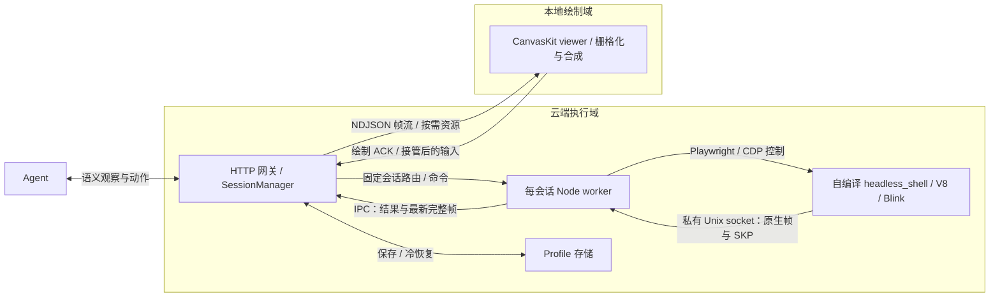

# virtual-desktop

面向 agent 的网页执行与本地绘制实验：**云端保留网页身份、脚本与交互状态，本地根据绘图记录生成画面；agent 与人工操作同一个持续会话。**

项目要验证的是：在保持任务成功率和画面正确性的前提下，将栅格化与最终显示移到客户端，能否降低服务端图形处理和画面传输的总成本。云端仍需运行 JavaScript、DOM、样式计算、布局和绘图记录生成。

截至 **2026-10-29**，仓库包含可运行的受限协议 PoC、自编译 Chromium 原生绘图与持续会话后端，以及共享 browser / 精简引擎实验。真实 Chromium 的固定页面已通过多层重放和交互验证；**通用网站与完整引擎切分关卡尚未通过**，仍保留 `engineSplitGate: not-passed`、`serverRasterBypassed: false`。

## 结构设计

### 执行与绘制的边界

网页处理可以分为三段：

| 阶段 | 放在哪里 | 主要工作 |
| --- | --- | --- |
| 网页执行与布局 | 云端执行会话 | 网络、存储、V8/Blink、DOM/CSS、事件、字体度量与布局 |
| 绘图记录与帧组织 | 云端执行会话 | 生成原生绘图记录，导出图层、合成 surface、变换、裁剪、透明度、滚动和资源引用 |
| 像素生成与显示 | 本地 viewer | CanvasKit 解码 SKP、栅格化、按帧合成并显示，完成后 ACK |

这里的 paint 是生成绘图记录，raster 是将记录变成像素；切分点位于两者之间。Chromium 的实际管线还涉及提交、激活和 aggregation，不能通过关闭 GPU 或使用 headless 推断这些工作已经消失。阶段划分参见 [RenderingNG 架构](https://developer.chrome.com/docs/chromium/renderingng-architecture)。

下图表示**当前已接入的原生后端**，云端与客户端是逻辑部署边界；当前实验在本机运行。



原生后端修改固定版本 **Chromium 156.0.8078.48**：在活跃图层树上导出完整帧及 Skia Picture（SKP），picture-layer 实验路径阻止 tile raster，headless Viz 候选沿 NullRenderer 路径跳过最终绘制。客户端使用匹配 Skia 版本和文字策略的 CanvasKit。源码、补丁、运行文件和 JS/WASM 均有指纹校验；内部记录与资源存在版本耦合，不能任意替换 Chrome 或 CanvasKit。实现与对照见 [引擎实验](docs/CHROMIUM_ENGINE.md)。

### 会话、控制权与帧一致性

**执行会话独立于 viewer。** agent 可以在没有 viewer 时读取语义状态、填写和点击；viewer 重连读取当前完整画面，不重放所有历史输入。人工接管沿用同一个真实页面，直接点击画面、打字或粘贴，归还后 agent 重新观察。

| 机制 | 设计与当前实现 |
| --- | --- |
| 调度单位 | session 固定绑定执行 owner；会话内动作串行，会话间可并行。准入、启动并发和等待队列有上限，不能按每个动作随机更换 worker |
| 控制权 | agent、只读 viewer、human 使用不同 capability；接管递增 control epoch，拒绝旧 owner 的写操作 |
| 动作一致性 | actionId 有界去重；坐标输入绑定已 ACK 的画面并校验当前视觉状态。结果未知时重新观察，不承诺跨故障 exactly-once |
| 完整帧 | 原生帧给出当前完整成员、层序、surface 和合成属性；删层立即反映到下一帧，不能只累加有变化的 SKP |
| 资源与背压 | SKP 按 SHA-256 标识并按需复用；每 viewer 最多 2 个未 ACK 帧与 1 个最新合并帧。通过长度、哈希、解码和本地绘制后才 ACK |
| 故障恢复 | 迟到帧不覆盖新画面；坏资源保留旧像素并停用输入，重连获取新快照。worker/browser 异常释放容量并通知 viewer |
| 持久化 | profile 单写、原子保存；原生后端冷恢复 cookies/localStorage，并创建新浏览器。JS heap、DOM、sessionStorage 和执行中的请求不随之恢复 |

control epoch 表示输入归属，连接 epoch/seq 表示帧通道，两者分别校验。具体约定见 [协议与 API](docs/PROTOCOL.md)、[完整帧](docs/CHROMIUM_FRAMES.md)和[持续会话](docs/CHROMIUM_LIVE.md)。

语义 agent 与视觉 agent 的要求也不同：如果 agent 必须读取截图，就需要一个在线绘制端生成像素；所有绘制端离线时，当前设计不能同时提供纯视觉观察和禁止云端像素生成的保证。

### 执行后端与多会话复用

| 路径 | 结构 | 当前用途与边界 |
| --- | --- | --- |
| 默认 v0 | 每会话 Node 子进程；LinkeDOM + Yoga → JSON 指令 → Canvas 2D | 验证协议、准入、接管、增量帧和保存恢复；仅受限 HTML/inline CSS 与内置可信程序，不运行真实网站 JS |
| 原生持续会话 | 每会话 Node worker + 独立 patched Chromium browser → 原生帧/SKP → CanvasKit | 真实网页引擎与实时交互实验；默认一个活跃原生会话，固定 fixture 已验证 |
| 共享 browser 原型 | 一个受监控 host → 每会话新建 BrowserContext → 独立 renderer/JS heap | 最多两个可信 fixture context 的复用实验；尚未接入正式 SessionManager 或公开 pool API |
| 多节点调度目标 | 新会话放置到有余量的 host，维护 session → host → context/renderer 路由 | 尚未实现跨节点资源调度、公平配额、自动扩缩容或热迁移 |

复用的重点是 browser host 与公共服务，**每个会话仍保留自己的网页执行状态**。[BrowserContext](https://playwright.dev/docs/browser-contexts)用于分离 Cookie 和网页存储；不能把它等同于共享一个 V8 heap，也不能据此获得不可信租户的 OS 安全隔离。当前共享原型按 renderer/lease 路由原生记录，关闭 context 后丢弃迟到帧；renderer 崩溃只终止对应 lease，browser 崩溃影响该 host 的全部 lease。后续接入需要有界 host 分片与排空回收，详见 [共享 Chromium 实验](docs/CHROMIUM_POOL.md)。

绘制卸载、进程复用和引擎裁剪解决不同问题：前者改变像素生成位置，复用减少重复的进程与管理开销，裁剪减少分发和不需要的功能依赖。它们都不会自动消除每个页面的 JS heap、DOM、布局、字体和图片内存。

## 与其他方案的比较

下面按执行和显示边界比较技术路线；实际成本取决于网页内容、编码方式、缓存、客户端和任务成功率。

| 方案 | 云端与本地的分工 | 适用点 | 对本项目目标的取舍 |
| --- | --- | --- | --- |
| 完整浏览器 + 截图/视频流 | 云端执行、生成像素并编码；客户端解码显示 | 复用浏览器现有显示结果，便于覆盖复杂画面与人工接管 | 云端承担像素与编码成本；压缩、硬件编码和帧间缓存可能很有效，不能预设其带宽一定更大 |
| DOM 同步/重建 | 云端执行并同步文档、样式和资源；客户端再次布局绘制 | 客户端可直接使用 DOM 与浏览器排版 | 需要处理状态同步、样式/字体差异、事件和 Canvas/iframe 等内容；本项目选择传原生绘图结果，避免另建一套画面 DOM |
| 纯语义自动化（Chromium + CDP/Playwright） | 云端浏览器执行，agent 读取结构化状态并发动作 | 无需人工画面时，接口直接，适合自动化任务 | 可作为本项目的控制通路，但控制协议本身不解决图形卸载，也不提供持续的本地接管画面 |
| 原生绘图记录远传（本项目） | 云端执行、布局与 paint；客户端重放记录并生成像素 | 保留真实网页状态，同时让 agent 与人工共用会话，验证减少云端图形负担的可能性 | 需维护 Chromium 改动、帧合成与资源协议；承担客户端 CPU/内存与 runtime 下载，复杂像素能力和通用兼容仍待解决 |

DOM 重建、像素流和绘图命令远传均有公开先例，参见 [Cloudflare 的路线说明](https://www.cloudflare.com/learning/access-management/what-is-browser-isolation/)。本项目的方向与其 NVR 的职责划分类似；公开的 [Canvas Remoting](https://developers.cloudflare.com/cloudflare-one/remote-browser-isolation/canvas-remoting/)也单独处理 Canvas 指令，并明确限制 2D 能力。这些资料支持路线可行性，不代表本项目已具备相同兼容性或性能。

RDP 也不是单一的视频传输模式：它包含内容分类、混合编码、自适应质量、差分和缓存等机制，不能直接用一个 JPEG 对照代表所有远程桌面方案，参见 [Microsoft 图形编码说明](https://learn.microsoft.com/en-us/azure/virtual-desktop/graphics-encoding)。

### 当前同构建实测

2026-10-28，Apple M4 / 16 GiB，同一 Chromium component 构建、960×720 固定页面，每种模式一个 browser，2 次预热后执行 20 次计数点击。原生模式消费 socket/IPC 记录，对照模式每动作生成 JPEG quality 80；计时止于**生产端结果就绪**。

| 指标 | 原生记录 | 常规 raster + JPEG |
| --- | ---: | ---: |
| 动作 p95 | 67.1 ms | 84.5 ms |
| 吞吐 | 15.14 次/s | 11.97 次/s |
| 进程树 CPU 时间增量 | 0.37 s | 0.77 s |
| 进程树 RSS 峰值之和 | 945.9 MiB | 916.0 MiB |
| 每动作原始生产产物 | 72,870 bytes SKP | 45,585 bytes JPEG |

这组样本中原生延迟更低，RSS 没有优势，全量 SKP 字节更多；原生还需约 1,613 bytes/动作的元数据。计时不含网络往返与客户端绘制，字节不含 viewer 资源复用、HTTP/TLS、压缩或首次 CanvasKit 下载，RSS 可能重复计算共享页。它不是优化视频流的对照，也不能外推网站容量。原始指标及限制见 [有限压测](docs/NATIVE_RUNTIME.md)。

资源复用另在多层 fixture 中验证：9 份唯一 SKP 共 207,309 bytes，逐帧重复发送全部引用则为 529,015 bytes。该差异只计算 SKP，不是完整网络带宽收益，见 [完整帧实测](docs/CHROMIUM_FRAMES.md)。

## 当前实验与结论

| 实验 | 已有证据 | 尚未建立的结论 |
| --- | --- | --- |
| [原生 SKP](docs/CHROMIUM_PAINT.md)与[引擎切分](docs/CHROMIUM_ENGINE.md) | 固定引擎 ordinary / remote-paint / record-only-display 三模式对照；匹配 CanvasKit 后固定页面严格视觉比较通过，record-only-display 的 trace 有正向 skip 标记且未观测到匹配 raster/draw | 普通 SKP 捕获仍会 raster；候选零 trace 记录不能独立证明所有像素路径消失，完整引擎关卡未通过 |
| [完整帧与本地合成](docs/CHROMIUM_FRAMES.md) | 6→5 个内容层、2 个 surface；层序、7° 旋转、clip、组 opacity、滚动与删层通过整图及逐区域比较 | 仅固定字体、A8 策略、DPR 1 的二维页面；一般字体/图片、滤镜和复杂合成未覆盖 |
| [持续会话](docs/CHROMIUM_LIVE.md)与[直接输入/准入](docs/NATIVE_RUNTIME.md) | 无 viewer 的 agent、接管/归还、直接键盘输入、ACK、刷新/断线/坏资源恢复、存储冷恢复；单会话 96 请求中 64 执行、32 限流 | 96 请求是同页串行队列测试，不是 96 个并行浏览器；物理 IME 和完整剪贴板行为未验收 |
| [运行包提取](docs/CHROMIUM_SUBSET.md) | 引擎与匹配 CanvasKit payload 共 684.5 MiB；提取包的真实输入、点击、去重及 5 帧/3 资源通过 | 不含 Node、仓库应用、Playwright 与系统依赖；不是 RSS 优化。额外 viewer 验证被整机压力保护阻止 |
| [共享 browser](docs/CHROMIUM_POOL.md) | 两个 context 的存储、输入、原生帧隔离，以及 context 回收、renderer/browser 故障范围通过；1/2 context 阶段 RSS 为 841.6/1,041.4 MiB | 约 199.7 MiB 增量是进程树 RSS 采样；无同条件双独立 browser 对照、唯一物理内存或长期容量结论 |
| [深度 lean 裁剪](docs/CHROMIUM_SUBSET.md) | 非 component、按体积优化，关闭 PDF/打印/部分 headless 命令；GN 配置与 V8 metagen 修复已验证 | 最新构建已因 RSS 上限保护停止，尚无新二进制、C++/视觉验收或体积/RSS 收益 |

**最新 lean 状态核对：**本机记录在 2026-10-29 **11:46（北京时间）**更新为 `safety-stopped`，最近并发为 2，停止原因 `owned-process-rss-limit`；6 GiB 编译进程树预算触发。此前的八任务与四任务记录属于更早阶段，不能继续视为正在运行。只读核对的状态与守护报告摘要见 [构建状态快照](docs/chromium-lean-status-2026-10-29.json)；该快照不触发续编，也不替换已验证运行时。

真实站点仍是待突破项：小红书普通对照遇到 IP 风险页；哔哩哔哩普通公开首页可加载，但原生探针在可接受的完整帧就绪前超过预算。两站原生交互入口均未开放，没有本地重放或视频支持结论，详见 [站点验证记录](docs/NATIVE_RUNTIME.md)。

### 后续验证重点

1. **字体与图片资源协议。** 当前字体嵌入 SKP，未覆盖中文字形触发系统回退时可能超过 8 MiB 原生消息上限；需要资源拆分、复用和生命周期管理，并实测客户端带宽与解码内存。
2. **扩大真实页面覆盖。** 补导航、多 renderer/widget、iframe、DPR/缩放和 IME；分别定义 Canvas/WebGL/video/readback 的支持或拒绝策略，并继续逐区域视觉比较。
3. **验证运行成本。** lean 工件完成后重跑 C++、原生帧/输入和视觉验收；以同等任务成功率比较 CPU、实际内存、网络与客户端负担，再评估共享 host 接入和容量。
4. **补齐部署边界。** 当前实验关闭 Chromium sandbox，子进程和 BrowserContext 分离不构成生产多租户隔离；跨节点 owner 路由、硬资源隔离、公平调度及自动回收仍需实现。

## 运行与复现

需要 **Node.js 22+**。默认入口运行 v0 协议 PoC：

```bash
npm ci
npm start
```

打开 <http://127.0.0.1:8080>，开发管理 token 为 `dev-local`。创建会话后，可在另一终端运行 `npm run demo:agent`；不打开 viewer 也能完成示例任务。v0 服务端不启动 Chromium，客户端使用 Canvas 2D。

原生后端需要按[构建说明](docs/CHROMIUM_ENGINE.md)准备已通过当前补丁验证的自编译引擎与匹配 CanvasKit，也可使用已提取的 runtime；不会自动替换为已安装 Chrome。以下为本机路径示例，其他环境需改为实际位置：

```bash
npm run start:native -- --root /Volumes/Extreme-APFS/Builds \
  --canvaskit /Volumes/Extreme-APFS/Builds/canvaskit/out \
  --port 8081 --max-active 1
```

打开 <http://127.0.0.1:8081/native>，创建会话并接管后可直接点击输入；Esc 返回本地工具栏。默认只开放可信 fixture，服务绑定 loopback。原生服务与实验保留 RSS、整机内存、换页和心跳保护，具体预算见 [运行限制](docs/NATIVE_RUNTIME.md)。

| 实验入口 | 复现说明 |
| --- | --- |
| `npm run experiment:paint` | [普通浏览器 SKP 捕获与重放](docs/CHROMIUM_PAINT.md) |
| `npm run experiment:engine` / `npm run experiment:frames` | [三模式引擎对照](docs/CHROMIUM_ENGINE.md) / [完整帧合成](docs/CHROMIUM_FRAMES.md) |
| `npm run experiment:live` / `npm run bench:native` | [持续会话验收](docs/CHROMIUM_LIVE.md) / [有限压测](docs/NATIVE_RUNTIME.md) |
| `npm run experiment:pool` | [同 host 的可信双 context 实验](docs/CHROMIUM_POOL.md) |
| `npm run package:native` / `npm run build:native-lean` | [运行包提取与受控裁剪构建](docs/CHROMIUM_SUBSET.md) |

除普通 paint 实验外，上表原生入口需按对应文档传入已验证引擎、匹配 runtime 或构建参数。恢复编译前先核对外置构建 state 和实际进程；避免重复构建，也不要与浏览器压测并行运行。

```bash
npm test
npm run check
npx playwright install chromium
npm run test:e2e
```

CI 在 `main` 推送和 PR 时执行检查与测试；原生 E2E 需要本机捕获及匹配 runtime，缺失时显式跳过对应项。普通协议和 v0 viewer 测试继续执行。复现方式见 [TESTING](docs/TESTING.md)，各阶段实际结果与未验证项见 [VALIDATION](docs/VALIDATION.md)。v0 的 `npm run bench` 仅测受限内置应用，不能代表 Chromium 网站容量。

## 代码与设计文档

| 位置 | 职责 |
| --- | --- |
| [src/](src/) | HTTP 网关、SessionManager、capability/控制权、worker 路由及原生帧状态 |
| [public/](public/) | v0 Canvas 2D viewer、原生 CanvasKit viewer、接管与本地输入 |
| [experiments/chromium-engine/](experiments/chromium-engine/) | Chromium/CanvasKit 补丁与构建、持续会话、共享 host、资源保护和基准 |
| [experiments/chromium-paint/](experiments/chromium-paint/) | 原生捕获、帧协议、校验、本地重放与视觉比较 |
| [test/](test/) | 协议、隔离/恢复、构建工具和浏览器 E2E |
| [docs/](docs/) | 专项设计、复现步骤与带日期的实测证据 |

[技术框架](TECHNICAL_FRAMEWORK.md)保留目标、术语与 v0 起点的设计边界；当前原生后端与实验进展以本 README 链接的专项文档及带日期证据为准。
