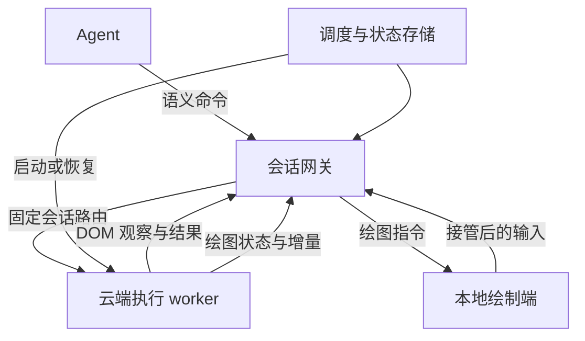

# 技术框架：云端执行，本地绘制

状态：v0 协议 PoC + 独立 Chromium 原生绘图实验；2026-10-27。本文取代先前研究报告中“完整 headless Chromium + 图像 viewer 为首版主路线”的选型结论。

## 1. 核心目标

服务面向 agent 保留独立的网页身份、交互状态和任务上下文；图形界面在用户本地生成。首要验证点是把网页逻辑执行与像素生成分离，减少云端图形处理、视频编码和画面传输开销，然后再验证高并发调度。

工程上区分三个层次：DOM/CSS 布局、生成绘图指令、将指令栅格化并合成像素。本项目首条技术路线允许前两项留在云端，把最终像素生成移到客户端。它不等于云端零布局计算，也不保证大多数网页的瓶颈都在栅格化。

硬约束：主要服务端执行链路不能调用截图、Canvas 像素生成、软件栅格器或视频编码来伪装成指令传输。遇到不支持能力必须显式报告；任何未来像素回退都应成为独立、可关闭和可计量的能力。

## 2. 架构

生产目标 worker 保留网络、网页脚本、DOM、布局及绘图指令生成；客户端执行栅格化、合成与显示。登录凭据、持久状态、控制权仲裁、调度元数据位于可回收执行域之外。

v0 使用可运行的小型替代执行引擎验证协议，不声称已经完成 Chromium 拆分：LinkeDOM 提供 DOM；Yoga 提供受限布局；内置可信示例程序使用 DOM 事件执行页面逻辑；绘图指令生成器输出矩形、文字和折线路径。客户端用 Canvas 2D 执行这些指令。服务器不依赖浏览器或像素生成库。

## 3. v0 能力边界

| 能力 | v0 | 后续通用浏览器目标 |
| --- | --- | --- |
| DOM 与 selector | LinkeDOM，受限文档 | Chromium/Blink |
| JS | 内置可信页面事件处理器 | 隔离的真实网站 JS |
| 样式与布局 | inline CSS 的 flex 子集 | 原网页 CSS 与字体语义 |
| 本地绘图 | rect/text/path 与增量更新 | 资源化 display list/Skia 等输出 |
| agent 接入 | 本项目 HTTP API 与示例客户端 | 评估 CDP/Playwright 兼容适配 |
| 网站导航 | 仅内置任务应用 | 任意获授权网站 |
| iframe/Canvas/WebGL | 不支持，不能用 demo 代替验证 | 单独定义支持范围与测试 |
| 状态恢复 | 示例应用 profile | 网站存储及独立文件 |
| 租户隔离 | 子进程分离，单用户本地实验 | sandbox/microVM、网络和资源隔离 |

v0 不运行上传的任意脚本，不使用 jsdom 的脚本执行来冒充安全浏览器。字宽和换行采用近似测量，不能用于评估复杂文字排版或真实网页视觉一致性。

## 4. 通信与一致性

agent 发送 click/fill 等语义操作，接收结构化可观察元素和执行结果。绘制端仅接收经过白名单序列化的绘图指令，不执行来源网页脚本。

每帧有协议版本、session_id、递增 seq、viewport 和显示命令。首次连接或增量基线失配时获取完整 snapshot；正常更新传 upserts/removes/order。重连以服务端当前状态为准，不通过重放全部历史输入恢复。

操作包含 action_id 与 control_epoch。相同 action_id 和相同负载只执行一次；同 id 不同负载被拒绝。进程故障导致结果未知时，客户端应重新观察，不自动重试副作用。v0 去重仅保证当前进程生命周期内，不能宣称跨故障 exactly-once。

坐标输入还需携带已显示 seq，服务器拒绝过期画面上的点击，防止视口或布局变化造成误操作。语义输入根据服务器当前 DOM 定位。

## 5. 控制权

管理 token、agent token、只读 viewer token、human token 分开。默认观察不获得控制权。人工接管递增 epoch 并阻止旧 agent 的全部写操作；归还后发放新 epoch。此时客户端应重新 observe，而不是继续执行接管前缓冲的动作。

HTTP 网关按能力鉴权。只读 viewer 不拥有浏览器级调试接口。token 使用请求头，viewer URL 不携带凭据。v0 管理 token 的本地默认值不是生产认证方案。

## 6. 调度单位与策略

- tenant：配额、授权和计量边界。v0 只有单用户开发域，不提供生产租户身份认证。
- profile：持久状态，单写租约。v0 保存内置示例应用状态，不包含真实浏览器 cookies。
- session：一个连续执行上下文，调度、超时、计量和控制权的主要单位。
- worker：承载 session 的可回收 Node 子进程；未来替换为真正的浏览器执行后端。
- renderer attachment：本地 viewer 与某个 session 的绑定，不决定云端执行上下文是否存在。

v0 限制活跃 session、等待请求和同时启动数量；等待队列 FIFO，超时明确失败。生产版本扩展为按 tenant 加权公平准入，并按 CPU、内存、启动压力和预算安排节点。v0 不实现跨租户公平性或节点资源调度。

已启动 session 固定绑定 worker。切换热会话只切换授权路由、绘图 snapshot 与本地缓存，不迁移 JS 堆。冷回收先停止新写入、保存 profile，再销毁进程；恢复会创建新 worker。保存采用临时文件与原子 rename；失败保留上个完整版本。v0 本地文件系统不是分布式持久存储。

ACTIVE → HOT_IDLE → EVICTING → COLD。v0 的冷热转换由显式 API 操作，自动 TTL 与资源压力驱逐是后续工作。冻结进程与 VM 快照不属于当前实现。

## 7. 本地离线与视觉 agent

viewer 不在线时，agent 可继续通过语义接口操作。无需生成并堆积每个历史显示帧；保留当前可重建的显示状态即可。重新连接获取当前 snapshot。

如果 agent 必须读取截图，就需要在线绘制端生成像素。严格禁止云端像素生成时，不能同时保证“所有本地端离线、纯视觉 agent 仍任意执行”。不得默默启动云端截图来绕过要求。

Canvas getImageData、WebGL readPixels、依赖像素的脚本和视频等是关键难点。可能需要远程结果返回、受限能力或显式回退；跨网络同步语义与吞吐不能从静态 demo 推断。v0 不支持这些能力。

## 8. 通用浏览器路线与关卡

先验证本仓库的协议 PoC，再开展 Chromium/Skia 输出切分技术实验：识别 paint/display list 截取位置、图层与字体/图像资源依赖、浏览器版本耦合和稳定的序列化格式。CanvasKit 可以作为客户端执行图形 API 的候选，但不能直接假设内部 Chromium PaintRecord 可无损发送给它。

通用浏览器 PoC 必须提交引擎改动、CPU/内存/线程 trace 与客户端视觉证据，证明实际绕过云端主要像素生成路径。单纯关闭 GPU、采用 headless、CDP 截图或 DOM 镜像均不构成该验收通过。

当前独立 [Chromium 原生绘图实验](docs/CHROMIUM_PAINT.md) 开始验证真实 HTML/CSS/JavaScript 的 SKP 捕获与 CanvasKit 重放，并保留 native paint 来源和 raster trace。它使用普通浏览器，尚未改动或禁用 tile raster；不更新上述关卡结论，也没有替换 v0 生产入口。

只有在同样任务成功率下，测得执行 worker 资源减少、传输和客户端负担可接受，才进入 100 活跃/1,000 冷 profile 的容量阶段。JS/DOM 内存仍保留；不能把降低显示带宽直接当作浏览器内存同比下降。

## 9. 验证

协议与集成测试覆盖：无 viewer 的 agent 流程、增量重建、多个会话状态分离、配额与排队、profile 单写与恢复、幂等输入、过期 seq、接管旧 epoch、观察权限、worker 意外退出。

浏览器端到端测试只把 Playwright 当作本地绘制端：检查 Canvas 实际像素、指令更新、人工接管和热会话切换。测试中启动 Chromium 不代表服务端依赖它。

benchmark 记录受限 demo 的创建/操作延迟、进程 RSS、绘图指令字节数、完整帧与增量对比，并记录硬件/Node 版本和样本数。不得将它标注为真实网站浏览器容量或隔离评估。

## 10. 一手资料

- [Chromium RenderingNG architecture](https://developer.chrome.com/docs/chromium/renderingng-architecture)：布局、paint、raster 与合成切分。
- [Cloudflare Browser Isolation](https://www.cloudflare.com/learning/access-management/what-is-browser-isolation/)：NVR 绘图指令传输的公开先例。
- [Cloudflare Canvas Remoting](https://developers.cloudflare.com/cloudflare-one/remote-browser-isolation/canvas-remoting/)：客户端 Canvas 绘制与能力限制。
- [Skia CanvasKit](https://skia.org/docs/user/modules/canvaskit/)：浏览器中运行 Skia 图形 API 的候选基础。
- [Microsoft RDP graphics encoding](https://learn.microsoft.com/en-us/azure/virtual-desktop/graphics-encoding)：RDP 也包含服务端编码，不能作为零云渲染的直接证据。
- [LinkeDOM](https://github.com/WebReflection/linkedom)、[Yoga](https://github.com/facebook/yoga)：v0 的 DOM 与布局组件。

资料仅支持技术原理与候选能力；本项目的收益、兼容性和安全性由本项目测试单独建立。
