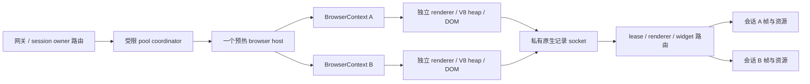

# 多会话复用 Chromium

2026-10-29：已实现并实测 `shared-native-host-candidate`。一个 patched `headless_shell` 承载多个独立 BrowserContext；本轮最多同时两个可信 fixture 会话。它是原生记录通路的复用实验，正式网关仍使用每会话 worker/browser，尚未接入公开 pool API。精简证据见 [chromium-pool-2026-10-29.json](chromium-pool-2026-10-29.json)。

## 复用的边界

可行方案是预热 browser host，在里面为每个 session 新建 BrowserContext。Playwright 的 [BrowserContext 隔离文档](https://playwright.dev/docs/browser-contexts)说明了 Cookie、localStorage、sessionStorage 等会话状态的分离。Chromium 固定版本的 `RenderProcessHostImpl::IsSuitableHost` 也明确拒绝把不同 BrowserContext 放进同一个既有 renderer（[固定提交源码](https://chromium.googlesource.com/chromium/src/+/d0c02bfad08ec92a6ffcf989e53cd995e6381a4c/content/browser/renderer_host/render_process_host_impl.cc)）。

| 部件 | 如何复用 | 必须保留的边界 |
| --- | --- | --- |
| Browser 主进程、进程管理和允许共享的服务 | 一个 host 承载多个会话，减少重复启动和管理开销 | 网络与存储状态仍遵守 BrowserContext/StoragePartition 分区；不能共享用户 Cookie 或认证状态 |
| V8/Blink 的引擎程序代码 | 同一版本运行文件，操作系统可共享只读文件映射页 | 独立 browser 本来就可能共享这些物理页；不能把 RSS 相加当成复制了 N 份引擎代码 |
| V8 isolate/JS heap、DOM、布局和 renderer | 每会话独立执行状态，随 BrowserContext 创建和销毁 | 不把不同用户放进同一个 heap，不复用上一用户尚存活的页面 |
| 本地 CanvasKit | viewer 可复用同一版本的代码与下载缓存 | 页面资源、帧、ACK 和输入权限继续按 session 隔离；本轮未测客户端解码内存 |

[V8 embedder 文档](https://v8.dev/docs/embed)中的 isolate 是有自己 heap 的 VM；V8 Context 是其中的执行环境，和 Chromium BrowserContext 不是一回事。单独搭建一个共享 V8 服务，不能直接替代 Blink renderer 内的脚本绑定、事件循环、DOM wrapper 和 GC 生命周期。把租户挤入一个 JS 引擎实例也不能消除各自的 DOM、heap、布局、图片和字体内存。



图中的 owner 路由是接入目标；当前实验由一个本机协调器直接创建会话，没有更改正式 SessionManager。

## 本轮实现

`shared-browser.js` 管理 browser 生命周期和有界 lease。`ChromiumSession` 可显式接受 shared host，默认独立路径保留。每个 lease 都新建 BrowserContext；关闭时只销毁自己的 context。共享 host 固定构建与补丁指纹，拒绝外部站点实验，仅允许配置的本机 fixture 路径。

一个 host 内只有一条带 capability 的私有原生 socket。绑定后的记录按 renderer PID 分给唯一 lease，再由 session 校验 widget/tree ID。不同 lease 不能认领同一个 renderer；关闭的 route 留 tombstone，迟到帧被丢弃，历史达到上限后拒绝新 lease，等待 host 排空回收。原始数据只在可信 coordinator 内处理，不广播给 viewer。

启动 provenance trace 是 browser 范围的操作，现由 host 串行执行；fixture URL 带唯一 lease 参数，避免相同页面地址导致 renderer 归属歧义。每会话诊断不能启动另一个 browser 范围的 trace。本轮没有去掉 producer 的来源校验，也没有用截图或 DOM 几何替代原生帧。

## 实测结果

Mac M4 / 16 GiB，使用已提取的相同 Chromium 156 component 运行包，960×720 本地 fixture，无额外 viewer。测试先在一个 context 中输入并写入 Cookie、localStorage 和 JS 标记，再创建另一个 context。两个 context 的 ID、renderer PID、状态、输入和原生帧来源均独立。

| 阶段 | 进程树 RSS 之和 |
| --- | ---: |
| 一个 BrowserContext | 841.6 MiB |
| 两个 BrowserContext | 1,041.4 MiB |
| 关闭 A，保留 B，再新建 C | 1,027.0 MiB |
| 第二个 context 的观测增量 | 199.7 MiB |

这些是同一短测试的阶段采样，包含 Node coordinator、watchdog、Chromium 及采样进程。共享页可被重复计入 RSS，并非唯一物理占用。本实验也减少了逐会话 Node worker，不能把结果全部归因于 V8/browser 复用；没有同条件两个独立 browser 的稳定态对照，不能推导百分比节省、生产容量或长期泄漏情况。

以下操作均通过：

- A/B 的 Cookie、localStorage、JS 标记、真实输入与原生帧分离；同一个 browser PID、不同 renderer PID。
- 关闭 A 后 B 继续操作；新建 C 不继承 A/B 状态。
- 用 CDP 故意使 C 的 renderer 崩溃后，B 仍能输入并输出原生帧。
- 新建 D 后故意结束共享 browser，B/D 两个剩余 lease 均收到 fatal 通知。

该轮约 14.5 秒，最低内存压力 free percentage 40%，新增系统 swapout 为 0，没有触发保护。报告在 `test-results/native-shared-host-faults-20261028/pool-report.json`，保留了第一次通过的较弱 browser-crash 实验。另行串行重跑独立 browser 路径：输入、点击、去重、5 帧/3 资源通过，无原生故障。81 项 JS、8 项 Python、81 个 JS 文件语法检查通过；本轮没有修改 Chromium C++ 源码，未重跑旧构建的 21 项 C++ 测试。

`engineSplitGate` 仍为 `not-passed`，`serverRasterBypassed` 仍为 `false`。此处证明的是可信 fixture 的生产端会话复用，尚无 viewer 视觉复测、一般网站、iframe/多 widget、视频/WebGL 或恶意租户隔离结论。

## 动态调度的接入顺序

1. 将一个 pool host 作为受监控的进程组，网关维护 `session → host → context/renderer` 的 owner 映射。同一会话的动作固定送到该 owner，并沿用 control epoch、actionId、串行动作和帧 ACK；不能逐动作随机负载均衡。
2. 按信任域、账号/代理策略和引擎版本拆 pool。优先复用有余量的预热 host，满时排队或新建 host；以实际内存、启动并发和队列预算准入，不按 CPU 核数直接设会话数。
3. 会话退出销毁整个 BrowserContext，下次创建全新的 context。达到 route 历史、进程寿命或内存阈值后停止接新 lease，等现有 lease 排空再回收 host；本轮只实现了拒绝准入，没有自动扩缩容。
4. renderer 崩溃终止对应 lease；browser 崩溃终止该 host 全部 lease，释放容量并通知客户端。重试必须建立新 lease/epoch，不能静默重放可能已执行的动作。
5. 跨 host 迁移先做 cookies/localStorage 的冷恢复。当前 JS heap、DOM、WebSocket、sessionStorage 和执行中的请求不能热迁移；交互会话切换可以换 viewer/control owner，而不搬运行状态。

BrowserContext 数据隔离不等于不可信租户的 OS 安全隔离。当前实验关闭 Chromium sandbox，不能直接对公网提供多租户服务。正式接入前还需 sandbox/容器或 microVM、每 host 硬资源上限、公平调度、故障回收、资源账本和权限测试。把所有用户塞进一个超大 browser 会扩大共同故障范围；推荐有界分片的多个小 pool。

## 复现

```bash
# 不要和编译或其他浏览器压测并行；最多两个可信 context。
nice -n 10 npm run experiment:pool -- \
  --root /Volumes/Extreme-APFS/Runtimes/virtual-desktop-native-156-20261028 \
  --canvaskit /Volumes/Extreme-APFS/Runtimes/virtual-desktop-native-156-20261028/canvaskit/out \
  --output test-results/native-shared-pool
```

继续使用原有保护：owned RSS 之和 1.5 GiB、整机 free percentage 35%、新增换页 64 MiB、heartbeat 4 秒、短测试最长 180 秒。只清理本测试注册的进程，保留用户已有服务与应用。
