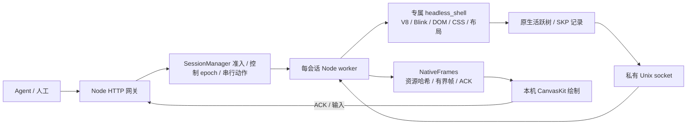

# 直接输入、后端调度与有限压测

## 2026-10-30 原始图片、Worklet 与哔哩哔哩输入

[本轮证据](chromium-native-images-2026-10-30.json) · [图片与输入协议](NATIVE_IMAGES.md)。最终包为 `/Volumes/Extreme-APFS/Runtimes/virtual-desktop-web-156-20261030`：13 个引擎文件、27 个 payload，共 529,317,559 bytes（504.8 MiB），字体预置资源沿用上一包。原始压缩图片通过私有二进制文件传输，SKP 只携带 `vdimage1` 哈希引用；本地 CanvasKit 持有压缩数据及 lazy SkImage，解码缓存设为 32 MiB。没有服务端截图或 PNG 转码回退。

已支持可见区域图片记录、圆角、`DstIn` 遮罩隔离及活跃树 PaintWorklet 记录。C++ 回归曾发现 image-filter 在解析前被当作空区域剔除，现已修复；record shader/filter 保留 SkPicture，嵌套原始图片也验证不调用服务端像素解码。

哔哩哔哩首页的空搜索热榜含动画图片。本轮明确使用**静态图片预览**：Chromium 自带 `imageAnimationPolicy=2` 固定首帧，资源标记 `animationPolicy:first-frame`；普通对照使用相同设置。未声明该策略的动画仍拒绝。网页 JS、CSS 动画、轮播与输入继续运行；这不是完整图片动画或视频支持。

完整帧围栏会因下方轮播改变而误拒绝顶部输入。现在点击只比较可能覆盖坐标的原生绘图：变换、裁剪、图层顺序、图片记录与遮挡仍参与校验；采用保守 AABB 和 2 px 边缘余量。跨进程在实际派发前再验一次。覆盖目标的变化、任何滚动和过旧快照仍拒绝；滚轮保持整帧校验。每 viewer 保留 2 份无资源字节的坐标元数据，键盘仍使用最多 16 份小型签名历史。ACK 的 `current` 表示整帧是否追上，不能替代点击区域校验。

最终验证：**135 JS、16 Python、101 JS 语法、25 cc + 4 Viz** 通过；7 组图片区域、缺失/损坏/截断资源及无标记 GIF 动画拒绝通过；完整帧、最终包 live 接管/恢复、共享 host 和冒烟通过。哔哩哔哩坐标点击首试被接受，随后 8 个字符直接输入真实搜索框，3 个输入请求成功、0 拒绝，无残留错误提示。该组合采样峰值 1,991.4 MiB，显式 2 GiB 预算；最终 live 1,414.7 MiB、smoke 505.4 MiB，均无新增换页。默认服务与单浏览器测试仍为 1.5 GiB。

最后的匹配策略对照中，两端均完成 4 次操作，原生生产端 p95 31.2 ms、JPEG80 对照 95.0 ms；但两个严格视觉阶段均失败，**不采纳性能收益比值**。这不包含 viewer 绘制或端到端延迟；密集文字差异仍未解决。单浏览器对照采样峰值 1,175.8 MiB，未触发保护。完整通用网站关卡继续为 `not-passed`，`serverRasterBypassed:false`。

构建常规 6 GiB RSS，最后 dry-run 确认仅 `[1/1] LINK ./headless_shell` 后单任务使用过 8 GiB 例外，free/swap/心跳保护保留。大型 artifact 哈希改为复用 64 KiB 缓冲，避免反复分配临时 chunk。成功浏览器轮仍显式使用进程内 GPU。小红书新会话 300012 尚未解除，不能把日常浏览器能访问误判为整个 IP 被封。

以下保留先前轮次的历史结果。

## 2026-10-30 字体 runtime 改造与验收

字体已改为独立二进制 runtime 资源，见 [本轮证据](chromium-font-runtime-2026-10-30.json)。本机入口为 `http://127.0.0.1:8082/native`，使用独立 profile、单活跃会话与原资源保护。新包位于 `/Volumes/Extreme-APFS/Runtimes/virtual-desktop-fonts-156-20261030`，payload **504.77 MiB**，包含 8 份预置字体/测试字形子集，合计 10,208,879 bytes。旧的 2026-10-28 component 和 2026-10-29 lean 包保留。

原生 SKP 使用 `vdfont01` 引用，保存字体文件 SHA-256 与不带字体流的 SkFontDescriptor。普通 SFNT 字体保留 collection index、可变轴、palette 与 synthetic style；字体程序不再进入帧 JSON、Base64 或 worker IPC。后台 MayBlock writer 先将独立 `.font` 文件原子写入 browser 的 0700 私有目录，再发布依赖它的帧。网关用 64 KiB 缓冲校验文件，保留已校验 inode；每个 HTTP 下载持有独立文件描述符，正常结束、取消和缓存淘汰都不会关闭其他下载或重连所需的句柄。worker 异常退出时，父进程清理其私有目录。

实测发现当前 macOS 苹方采用 Apple `hvgl` 表，FreeType 无法读取这份约 59.43 MB 的字体程序。此类字体改用 `vdglyph1` 二进制轮廓资源：从原生 typeface 提取用到的矢量字形，保留原 glyph ID、实例身份与规范化 metrics；**没有生成服务端像素，也没有换用另一套字体**。8 个中文字符的轮廓资源为 **7,952 bytes**。子集在出现新字形时累计扩展；这不是细粒度 glyph delta 协议。每实例最多 4,096 个字形，单资源 64 MiB、资源缓存 128 MiB；超限明确拒绝。客户端及时释放不再使用的字体版本及其 picture，避免小型稀疏子集积累成大量解码内存。

CanvasKit 的 viewer 独享 `RemoteFontRegistry` 负责解析字体引用。客户端先检查资源长度与 SHA-256、加载依赖字体，再解码 SKP；缺失字体或字形时不呈现、不发 ACK。故意从中文字体移除一个中间 glyph、重新计算字体哈希并改写 SKP 引用后，客户端仍正确拒绝。仅预加载 CSS 字体或创建普通 FontMgr 无法替代这条解析路径。

运行包通过 `package:native -- --font-assets <目录>` 预置 `fonts/catalog.json` 指定的资源。客户端从 `/native-runtime/fonts/<sha>.font` 加载并使用不可变 HTTP 缓存；其他网站字体仍走带 session capability 与 in-flight frame 约束的二进制接口。预置的两个中文资源是测试字形子集，不能当作完整中文字库。稳定字体在后续帧中复用：真实 viewer 的计时器测试增加了 5 次 picture 资源下载，字体下载次数仍为 1。

验收结果：**117 JS、16 Python、98 JS 语法、19 cc + 4 Viz** 通过；9/9 字体探针完成原生导出与本地解码重放；动态字体与预置字体的完整接管、中文输入、滚动、离线重连、reload、损坏资源恢复均通过，两处独立 fixture 画面对比通过；共享 host 的两个可信 context 回归通过。字体探针最大进程树 RSS 789.7 MiB，两个组合 live 测试约 1,542/1,563 MiB，均无新增换页。默认浏览器预算仍为 1.5 GiB，只有显式组合 live 测试使用 2 GiB。所有成功浏览器测试仍使用显式进程内 GPU 模式。

CERN 的 SKP 从 769,855 降到 **13,751 bytes（减少 98.21%）**；756,248 bytes 字体程序成为独立资源。未预置字体的首次冷加载仍要传这些二进制，首次全部引用资源为 769,999 bytes，不能把 SKP 缩小直接当作冷网络流量或端到端速度收益。两种生产端均运行成功，但严格局部文字像素仍失败，性能比值保持不采纳。9 个字体探针的密集文字区域也只有 1 个通过，不能用整页白色背景稀释误差来声称画质通过。`engineSplitGate=not-passed`、`serverRasterBypassed=false` 保持不变。

后续优先处理字体像素匹配、图片资源、长会话 glyph delta 与生命周期，再扩大真实网站/iframe/媒体/IME/DPR 覆盖。默认独立 GPU 启动仍未解决。编译默认 6 GiB RSS；实际只剩单个最终链接时，在主机 free 71%、零新增换页条件下单独使用过 8 GiB 上限，实际峰值约 6.24 GiB。35% free、最近换页和心跳保护均保留。

以下是改造前的原因诊断，历史状态以本节的新结果为准。

2026-10-30 已完成本轮失败原因的因果诊断，见 [原始证据索引与结果](chromium-native-diagnosis-2026-10-30.json)。本轮没有重编 Chromium、提高资源上限或用截图替代原生输出。

| 失败点 | 已确认的原因与对照 | 当前处理 |
| --- | --- | --- |
| `frame-too-large` | SKP 默认以 `kDoIncludeData` 嵌入完整字体，没有按使用字形裁剪、也没有跨 SKP 字体引用。CERN 一份 769,855-byte SKP 中，Times 两个字体占 756,248 bytes（98.23%） | 需要字体/字形资源、保持 glyph ID 的子集和缓存；扩大上限会继续重复发送大字体 |
| Python 图片记录 | C++ 明确拒绝含 discardable images 的 DisplayItemList。相同本地页中，无图片及 inline SVG 可导出；已加载的 2×2 PNG `` 与 PNG 背景均被拒绝 | 需要原始图片资源封装和重放，不能直接跳过检查或丢弃图片 |
| CERN 文字画质 | 同一原始 SKP 在 macOS Chromium 重放，与普通原页 PNG 的逐像素误差为 0；CanvasKit 则稳定出现 3 个失败区域 | 已定位客户端字体栅格行为差异；并非这页的记录丢失或布局错误。需匹配字体栅格策略或提供匹配的本地重放后端 |
| IANA 来源绑定 | `FillFrameData` 在 renderer 尚未就绪时不写 PID，随后发 `ProcessReadyInBrowser`；旧解析器忽略该事件，切换中的旧/新 renderer 又同时上报相同 frame | 已修复：优先解析浏览器 readiness 事件；歧义时仅在 frame/URL/loader 稳定条件下补一份导航后来源快照。真实 IANA 复测成功绑定，随后正确报告超大帧，仍非网站通过 |

字体对照只改变本地测试页的字体，文本和字号保持一致：29 个拉丁字符使用小字体时 SKP 22,085 bytes，Times New Roman 时 825,469 bytes，`system-ui` 时超限；只有 8 个中文字符也超限，小字体缺字后回退到苹方仍超限。CoreText 表尺寸按 Skia 相同的完整 SFNT 构造方式估算，且只接受精确 PostScript 名匹配：`.SFNS-Regular` 7,872,432 bytes，Base64 后仅字体就有 10,496,576 bytes；苹方约 59.43 MB，Base64 后约 79.24 MB。当前 8 MiB 限制针对整份 JSON，包含内嵌 SKP 的 Base64，因此少量字符也能超过上限。表尺寸是源数据估算，拒绝后的超大线上帧没有被保存。

上轮将 Example 当作轻量英文页的分类不准确：实际截图包含中文、阿拉伯文等多语种文本。本轮没有继续访问它做探针，改用本地合成文本确认系统字体与回退字体的影响。

字体像素诊断使用原始捕获字节、原背景和未改动的比较阈值：普通参考图跨轮误差为 0，macOS 重放原 SKP 误差也为 0；CanvasKit 整图 MAE 1.658、局部 3/9 区域失败。Skia 版本一致，但 macOS 字体后端为 CoreText，当前软件 CanvasKit 为 FreeType；现有额外 stem-darkening 校准针对 CFF，CERN 使用的是 TrueType Times。CSS `antialiased` 对照仍有 2/9 区域失败，不能用一个 CSS 开关替换正式参考图；具体栅格参数仍需继续归因。macOS raster PNG 仅用于这项独立诊断，未进入原生生产端或 viewer 回退。

105 JS、16 Python、95 JS 语法检查，以及原生 fixture 冒烟和共享 host 回归通过。诊断工具保持单测试 browser、1.5 GiB 进程树预算及原 free/swap/心跳保护；`native-diagnostics-complete` 只表示证据收集完成，不是网站验收。字体与图片协议、默认字体像素匹配仍未完成，独立 GPU 启动问题也不在本轮进程内 GPU 诊断中解决。

2026-10-29 的真实网站与性能结果见 [六站实测](chromium-sites-2026-10-29.json)。本轮使用同一 lean 主程序、960×720 / DPR 1、显式 macOS 进程内 GPU，两种模式遵守同一 HTTPS 白名单，顺序启动全新 browser/context。每种模式先预热 2 次，再做 8 次本地搜索框编辑或 Tab/Shift+Tab；不提交搜索、不登录、不主动播放视频。CERN 另做 AB/BA 两轮。**没有一个公开网站达到本轮严格画质与功能验收，不能声称通用网页性能收益。**

| 页面 | 普通 Chromium | 原生记录 |
| --- | --- | --- |
| Example Domain | 加载、焦点操作通过 | `frame-too-large`，超过 8 MiB JSON 帧上限 |
| IANA example-domains | 加载、焦点操作通过 | 主文档来源绑定未能证明；早期另收到超大帧错误 |
| Python.org 文档 | 加载、搜索框编辑通过 | `picture-images-or-missing-record`，图片记录尚不支持 |
| CERN 原始网站 | 加载、焦点操作通过 | 两轮持续输出、解码及 ACK 通过；局部文字像素未过阈值 |
| 哔哩哔哩首页 | 加载、搜索框编辑通过 | `frame-too-large` |
| Hacker News | HTTP 503 | 原生导航失败，没有有效对照 |

修复了启动时的主 widget 绑定：同一 renderer 可能同时残留 about:blank 和目标文档的 compositor，不能只选这个 PID 最新到达的消息。现在以 `Page.getFrameTree`、精确 URL/renderer commit 与 `SetLayerTreeId` 证明当前主 widget；只忽略 trace 明确证明已退役的旧 widget，未知新增 widget 继续拒绝。该修复不改 C++、二进制或像素输出路径。CERN 从误绑旧 widget 变为两轮共 16 次原生操作、4 个离线重放状态均解码/ACK 成功；图片、超限帧及缺失来源均没有用截图替代。

CERN 直接生产端动作 p95 为原生 **33.2 / 35.3 ms**、普通 JPEG80 **51.0 / 51.0 ms**，采样 RSS 之和分别约 **675.9 / 676.2 MiB** 和 **601.7 / 618.0 MiB**。每轮 8 次操作，原生生产 6,159,512 bytes SKP 加元数据，JPEG80 为 579,264 bytes；预热已覆盖重复焦点状态，新增唯一资源为 0，这只是潜在缓存复用，并非实测客户端带宽。原生整图误差通过，但 9 个固定区域中 3 个失败；JPEG80 对照本身也未通过严格区域阈值。二者都没有取得等画质资格，工具不输出收益比值；未放宽原来的 MAE≤3 / 超 32 误差像素比例≤2% 阈值。

另外在固定 live fixture 上复测原有独立 worker 性能工具：12 次计数点击，结果如下。这一组包含 worker IPC，不能和上面的公开网站直接生产端耗时混用；它也没有定量检查 JPEG80 画质等价。

| 固定页指标 | 原生记录 | 传统 raster + JPEG80 |
| --- | ---: | ---: |
| 动作 p95 | 68.4 ms | 87.8 ms |
| 总进程 CPU 时间增量 | 0.42 s | 0.53 s |
| 采样进程 RSS 峰值之和 | 831.2 MiB | 772.1 MiB |
| 每动作原始生产 payload | 72,869 bytes SKP，另约 1,613 bytes 元数据 | 45,529 bytes JPEG |

这说明固定任务下记录通路可以更快，但本轮没有内存优势，原始生产字节更多；没有测客户端解码/绘制成本、完整网络带宽或优化视频方案。96 请求突发仍为 64 成功 / 32 限流，16 个额外会话全部拒绝，没有扩张浏览器数量。

本轮全部站点尝试均按单执行 browser、1.5 GiB RSS 预算与原有 free 35% / swapout 64 MiB / 心跳 4 秒保护运行，先关闭生产端再单独开离线重放 browser。最高采样树 RSS 1,411.7 MiB、最低 free 70%、新增 swapout 0，没有安全停止；结束检查 ToDesk 仍在运行，无遗留 headless/编译进程。这不是 ToDesk 远端时延保证。100 JS、16 Python、91 JS 语法检查通过，既有原生 fixture 冒烟和双 context pool 回归通过。各原始失败与早期工具错误保留，未启用网站交互选项；Example 也因已确认超限改为 probe only。

后续优先做字体/字形及原始图片资源协议、定位超大记录来源、匹配默认字体像素，并修复剩余 IANA 来源绑定；先通过公开网页功能和画质，再比较等画质性能。独立 GPU 启动、真实 OS 输入法、多 iframe/导航/视频与更高并发仍未验收。

2026-10-29 后续：lean monolithic 已完成同配置 21 项 C++ 测试和 495.0 MiB 独立包；可信 fixture 的完整帧/视觉、单会话 live 接管恢复及双 context 共享 host 测试通过。**成功轮显式使用 macOS 进程内 GPU；默认独立 GPU 子进程启动仍有 rAF 停滞问题，不能推广为默认模式通过。** 具体模式、保护停止、采样内存和未覆盖项见 [本轮验收](chromium-lean-acceptance-2026-10-29.json) 与 [复现命令](CHROMIUM_SUBSET.md)。下文 2026-10-28 的 benchmark 和真实网站失败记录保留为历史，不是新 lean 构建的内存/容量结论。

2026-10-28：接管后直接点击远端画面的输入框并打字，已移除独立文字栏。单会话的原生记录/JPEG 生产端对照和 96 请求突发完成；小红书与通用网站仍未通过。实际指标、构建指纹、保护停止及未验证范围保存在 [chromium-runtime-2026-10-28.json](chromium-runtime-2026-10-28.json)。

2026-10-28 已提取 684.5 MiB 的 component 引擎/CanvasKit 包，本地原生生产端通过，当时手动 viewer 验证被整机压力保护阻止；见 [子集记录](chromium-subset-2026-10-28.json)。当时 8082 空闲服务改用该包；本轮没有替换 8081/8082 配置。打包不等于 RSS 优化或真实网站关卡通过。

2026-10-29 已增加[多会话复用原型](CHROMIUM_POOL.md)：一个 browser、独立 BrowserContext/renderer/JS heap，可信 fixture 的存储、输入、帧路由、context 回收与崩溃测试通过；正式网关仍保留下面的独立 worker/browser 结构。早期 component 测量见[共享 host 记录](chromium-pool-2026-10-29.json)，后续 lean 与显式 GPU 模式的结果见本页上方链接，不能混用两轮 RSS 数字。

## 输入与页面兼容

本地不可见 textarea 接收系统文字输入、粘贴和组合事件；只把提交后的文字送到真实 Chromium。画面点击先定位远端焦点，后续键盘按有界队列顺序执行，连续文字合并；输入绑定原会话与 control epoch，控制权改变时取消待发输入。已确认帧保留最多 16 项小型签名历史，避免新 ACK 与键盘请求竞态；坐标输入仍必须对应当前画面。

支持常规文字、粘贴、Tab/Enter/删除/方向键/Shift 选择及全选、撤销/重做。Esc 释放本地键盘捕获并回到工具栏。系统剪贴板的复制/剪切、完整移动端行为及物理 IME 候选窗没有完成验收。自动化只注入组合事件验证一次提交；本机浏览器实操另确认了英文、已覆盖字形的中文、全选和 Esc。证据为 `test-results/direct-input-live.png`。

中文不是全面兼容：缺字会触发系统字体回退，当前 SKP 可能嵌入整套大字体，实测超过 8 MiB 单条记录上限。文字已到达真实 DOM，但画面停止支持；不会回传截图或放宽上限。下一步需要字体/字形资源协议和生命周期，不能靠扩大帧缓存代替。

真实站点使用显式 HTTPS 白名单，拒绝其他域、端口、凭据 URL 与文件协议；默认仍只开放固定 fixture。`--external-sites` 仅供预览实验，不构成任意网站支持。小红书的普通无头对照进入 IP 风险页（300012）；原生探针在首帧就绪前超过进程 RSS 预算，被安全停止。XHS 的交互选择因此禁用。轻量 HTTPS 页面预览也触及本机预算，没有宣称通过外部网页视觉验收。

随后按用户要求改测哔哩哔哩公开首页，普通与原生分别运行，未登录、未点击视频。普通 Chromium 返回 HTTP 200，保持首页 URL，标题和内容正常，55/55 张图片已加载；截图为 `test-results/chromium-bilibili-ordinary-20261028/ordinary-public-page.png`。测试采用与原生相同的域名策略，另有两个 `s1.hdslb.com` 请求被拒绝；完整跨域 iframe 行为没有验收。普通访问没有遇到此前的小红书 IP 风险页。

哔哩哔哩原生探针因超过预算而停止，采样进程树 RSS 之和为 1,615.5 MiB；含初始化和清理共约 7.1 秒。watchdog 清理了测试进程，此时尚未收到可接受的完整原生帧。本地重放、输入与视频播放均未验证，交互入口保持禁用，没有扩大阈值或用截图代替原生画面。普通对照采样 RSS 峰值为 1,281.6 MiB；两轮内存压力命令的最低 free percentage 分别为 39%/38%，观测到的新增 swapout 均为 0。这是不同初始化路径的短测试，不能据此得出稳定态内存或性能结论。

## 当前后端



当前所有组件都在这台 Mac；Unix socket 是执行端内部通道，跨网络部分预留为网关到 viewer 的帧/资源传输。真实页面的 JS、DOM、CSS、布局和事件仍由完整 Blink/V8 执行，SKP 和变换来自原生活跃树，不从 DOM 几何重建。Skia 记录、字体处理与某些资源解码仍在执行端，关闭特定 raster/display 路径没有把 Chromium 裁成轻量 JS/布局包。

v0 的 LinkeDOM/Yoga 后端继续独立存在；本页所有原生指标都没有使用 v0 模拟结果。`engineSplitGate: not-passed`、`serverRasterBypassed: false` 保留。

## 调度与恢复

| 范围 | 当前行为 |
| --- | --- |
| 准入 | 单机有界队列；原生会话另有总数上限，满时直接 429。当前本地 CLI 默认 1 个活跃会话、1 个启动任务，显式可选 2；测试发现该机双浏览器启动超预算，未继续 |
| 执行 | 每会话独立 Node worker 和 browser 进程组；不同会话可并行，同一页面的动作串行，命令队列最多 64 项 |
| 控制 | agent/human capability 与 control epoch；旧 owner、只读操作和过期坐标拒绝；actionId 去重 |
| 帧 | 原生 writer 和 worker IPC 各保留正在发送及最新待发状态；每 viewer 最多 2 个未 ACK 帧加 1 个最新合并帧 |
| 资源 | SHA-256 原始 SKP、按需获取和复用；总计 128 MiB 序列化缓存，不等于解码后的 WASM/RSS 上限；每会话最多 4 个 viewer |
| 生命周期 | viewer 断开不停止执行；browser/renderer 或 worker 崩溃清理专属进程组、释放准入槽，终止状态通知 viewer |
| 冷恢复 | JSON 原子保存 cookies/localStorage，恢复时新建浏览器；不是 JS heap、DOM 或 sessionStorage 快照 |

这还不是分布式负载均衡：没有跨节点 worker 池、资源感知放置、自动闲置回收或热迁移。已有状态绑定当前执行进程，不能对每个动作随机分配 worker。后续应按新 session 放置并维护 owner 路由，在节点内做公平有界队列和资源准入；控制转移仍需明确排队/取消策略。当前大量请求会产生串行排队，不能把 96 HTTP 请求等同于 96 个并行浏览器。

## 同构建对照

Mac M4 / 16 GiB，同一固定 Chromium 156 component 构建、960×720 fixture，每种模式一个浏览器、2 次预热、20 次计数点击。原生模式消费 socket/IPC 记录，传统模式每次操作后生成 JPEG quality 80。计时到生产端结果就绪，不含客户端绘制和网络往返。

| 指标 | 原生记录 | 传统 raster + JPEG |
| --- | ---: | ---: |
| 动作 p95 | 67.1 ms | 84.5 ms |
| 吞吐 | 15.14 次/s | 11.97 次/s |
| 进程树 CPU 时间增量 | 0.37 s | 0.77 s |
| 进程树 RSS 峰值之和 | 945.9 MiB | 916.0 MiB |
| 每动作原始生产产物 | 72,870 bytes SKP | 45,585 bytes JPEG |

原生另有约 1,613 bytes/动作的元数据。以上字节是到 Node 协调端的生产产物，未计网关对客户端的资源复用、HTTP/TLS、压缩或首个 CanvasKit 下载，不能当成实际网络带宽。RSS 含协调器、Node workers 和浏览器进程，共享页可能重复计数，不是唯一物理内存。CPU 使用进程累计计时的小样本差值，后台应用与采样会带来噪声。

本轮原生延迟更低，但内存没有明显优势，全量 SKP 生产字节更大。传统对照不是优化过的硬件视频编码、持续 screencast 或共享 browser/context 池；不能据此给所有 Chromium 部署排序，也不能外推生产容量。客户端 CanvasKit 的 CPU、解码内存和完整运行时分发体积尚未测量。

## 并发与保护结果

在同一个真实原生会话上同时发出 96 个操作：64 个执行成功、32 个因队列满返回 429，最终计数为 64，无重复执行或非预期错误。成功请求 p95 为 4,087 ms，反映同页串行排队；另 16 个额外会话申请在容量已满时全部 429，没有创建更多浏览器。该轮进程树 RSS 峰值之和约 1,033.5 MiB，新观测到的系统 swapout 为 0。

早期增加至两个测试浏览器时，按秒采样在约 1,749 MiB 发现超过 1.5 GiB 预算，立即清理测试进程，没有提高阈值重试。加入独立参考浏览器的严格图像复测同样超预算，明确标记停止；未把旧构建的图像通过冒充新构建复测通过。新构建另有真实本机 UI 直接输入/绘制证据。

独立 watchdog 保护协调器卡顿、整机压力、进程树 RSS 和新换页；测试最长 180 秒、低优先级运行，最多尝试 2 个测试浏览器，默认只测 1 个。阈值为内存压力命令报告的 free percentage ≥35%、新增 swapout ≤64 MiB、owned RSS 之和 ≤1.5 GiB、heartbeat ≤4 秒。长期交互服务不设 180 秒上限，换页按最近 10 秒窗口判断，监控样本有界；停止原因写到终端与 `/health.nativeResources`，触发后拒绝新会话直到服务重启。已退出 worker 从监控目标移除。采样保护不是 OS 硬隔离，也不保证毫秒级止损。

并发还发现并修复了原生稳定性问题：无显示模式持续得到失败 presentation feedback，但 Blink/cc 把只等待成功的回调留到未来，61 个待处理帧触发上限为 60 的 DCHECK。现仅在两个实验 feature 同时开启时取消失败帧对应的成功回调，普通模式继续保留重试；不伪造服务端呈现，客户端 ACK 也没有冒充物理显示时间。新增 120 帧失败压力及普通模式回归，过滤 C++ 共 21 项通过；新构建完成 64 个队列内操作不再崩溃。

另一个跨站初始化问题来自给诊断 producer 配置 32 MiB 共享内存，而上游 child-process 共享内存 switch 上限为 8 MiB。持续会话改为 8 MiB，画面仍走 socket；没有提高上游安全上限。

## 复现

```bash
# 默认单会话，带长期资源保护；不要同时启动多个压测。
npm run start:native -- --root /Volumes/Extreme-APFS/Builds \
  --canvaskit /Volumes/Extreme-APFS/Builds/canvaskit/out --port 8082

nice -n 10 npm run bench:native -- --root /Volumes/Extreme-APFS/Builds \
  --canvaskit /Volumes/Extreme-APFS/Builds/canvaskit/out --iterations 20 --max-active 1

# 站点诊断默认串行执行原生导出和普通参考，不同时开额外 viewer。
nice -n 10 npm run experiment:site -- --root /Volumes/Extreme-APFS/Builds \
  --canvaskit /Volumes/Extreme-APFS/Builds/canvaskit/out --site xiaohongshu

# 可先测普通公开页，再独立测原生导出；顺序运行，不要并行。
nice -n 10 npm run experiment:site -- --root /Volumes/Extreme-APFS/Builds \
  --site bilibili --mode ordinary --output test-results/bilibili-ordinary
nice -n 10 npm run experiment:site -- --root /Volumes/Extreme-APFS/Builds \
  --canvaskit /Volumes/Extreme-APFS/Builds/canvaskit/out \
  --site bilibili --mode native --output test-results/bilibili-native
```

后续优先做字体/图片资源切分与实际客户端带宽、最小 runtime 包及长会话内存测试，再在具备硬隔离和更大资源预算的构建/测试机验证真实网站、多个 renderer/iframe、IME/DPR，以及大规模独立活跃会话。当前无 Chromium sandbox 的本地实验不可直接当作公网多租户服务。
