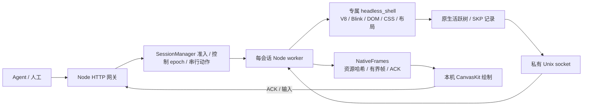

# 直接输入、后端调度与有限压测

2026-10-28：接管后直接点击远端画面的输入框并打字，已移除独立文字栏。单会话的原生记录/JPEG 生产端对照和 96 请求突发完成；小红书与通用网站仍未通过。实际指标、构建指纹、保护停止及未验证范围保存在 [chromium-runtime-2026-10-28.json](chromium-runtime-2026-10-28.json)。

## 输入与页面兼容

本地不可见 textarea 接收系统文字输入、粘贴和组合事件；只把提交后的文字送到真实 Chromium。画面点击先定位远端焦点，后续键盘按有界队列顺序执行，连续文字合并；输入绑定原会话与 control epoch，控制权改变时取消待发输入。已确认帧保留最多 16 项小型签名历史，避免新 ACK 与键盘请求竞态；坐标输入仍必须对应当前画面。

支持常规文字、粘贴、Tab/Enter/删除/方向键/Shift 选择及全选、撤销/重做。Esc 释放本地键盘捕获并回到工具栏。系统剪贴板的复制/剪切、完整移动端行为及物理 IME 候选窗没有完成验收。自动化只注入组合事件验证一次提交；本机浏览器实操另确认了英文、已覆盖字形的中文、全选和 Esc。证据为 `test-results/direct-input-live.png`。

中文不是全面兼容：缺字会触发系统字体回退，当前 SKP 可能嵌入整套大字体，实测超过 8 MiB 单条记录上限。文字已到达真实 DOM，但画面停止支持；不会回传截图或放宽上限。下一步需要字体/字形资源协议和生命周期，不能靠扩大帧缓存代替。

真实站点使用显式 HTTPS 白名单，拒绝其他域、端口、凭据 URL 与文件协议；默认仍只开放固定 fixture。`--external-sites` 仅供预览实验，不构成任意网站支持。小红书的普通无头对照进入 IP 风险页（300012）；原生探针在首帧就绪前超过进程 RSS 预算，被安全停止。XHS 的交互选择因此禁用。轻量 HTTPS 页面预览也触及本机预算，没有宣称通过外部网页视觉验收。

## 当前后端



当前所有组件都在这台 Mac；Unix socket 是执行端内部通道，跨网络部分预留为网关到 viewer 的帧/资源传输。真实页面的 JS、DOM、CSS、布局和事件仍由完整 Blink/V8 执行，SKP 和变换来自原生活跃树，不从 DOM 几何重建。Skia 记录、字体处理与某些资源解码仍在执行端，关闭特定 raster/display 路径没有把 Chromium 裁成轻量 JS/布局包。

v0 的 LinkeDOM/Yoga 后端继续独立存在；本页所有原生指标都没有使用 v0 模拟结果。`engineSplitGate: not-passed`、`serverRasterBypassed: false` 保留。

## 调度与恢复

| 范围 | 当前行为 |
| --- | --- |
| 准入 | 单机有界队列；原生会话另有总数上限，满时直接 429。当前本地 CLI 默认 1 个活跃会话、1 个启动任务，显式可选 2；测试发现该机双浏览器启动超预算，未继续 |
| 执行 | 每会话独立 Node worker 和 browser 进程组；不同会话可并行，同一页面的动作串行，命令队列最多 64 项 |
| 控制 | agent/human capability 与 control epoch；旧 owner、只读操作和过期坐标拒绝；actionId 去重 |
| 帧 | 原生 writer 和 worker IPC 各保留正在发送及最新待发状态；每 viewer 最多 2 个未 ACK 帧加 1 个最新合并帧 |
| 资源 | SHA-256 原始 SKP、按需获取和复用；总计 128 MiB 序列化缓存，不等于解码后的 WASM/RSS 上限；每会话最多 4 个 viewer |
| 生命周期 | viewer 断开不停止执行；browser/renderer 或 worker 崩溃清理专属进程组、释放准入槽，终止状态通知 viewer |
| 冷恢复 | JSON 原子保存 cookies/localStorage，恢复时新建浏览器；不是 JS heap、DOM 或 sessionStorage 快照 |

这还不是分布式负载均衡：没有跨节点 worker 池、资源感知放置、自动闲置回收或热迁移。已有状态绑定当前执行进程，不能对每个动作随机分配 worker。后续应按新 session 放置并维护 owner 路由，在节点内做公平有界队列和资源准入；控制转移仍需明确排队/取消策略。当前大量请求会产生串行排队，不能把 96 HTTP 请求等同于 96 个并行浏览器。

## 同构建对照

Mac M4 / 16 GiB，同一固定 Chromium 156 component 构建、960×720 fixture，每种模式一个浏览器、2 次预热、20 次计数点击。原生模式消费 socket/IPC 记录，传统模式每次操作后生成 JPEG quality 80。计时到生产端结果就绪，不含客户端绘制和网络往返。

| 指标 | 原生记录 | 传统 raster + JPEG |
| --- | ---: | ---: |
| 动作 p95 | 67.1 ms | 84.5 ms |
| 吞吐 | 15.14 次/s | 11.97 次/s |
| 进程树 CPU 时间增量 | 0.37 s | 0.77 s |
| 进程树 RSS 峰值之和 | 945.9 MiB | 916.0 MiB |
| 每动作原始生产产物 | 72,870 bytes SKP | 45,585 bytes JPEG |

原生另有约 1,613 bytes/动作的元数据。以上字节是到 Node 协调端的生产产物，未计网关对客户端的资源复用、HTTP/TLS、压缩或首个 CanvasKit 下载，不能当成实际网络带宽。RSS 含协调器、Node workers 和浏览器进程，共享页可能重复计数，不是唯一物理内存。CPU 使用进程累计计时的小样本差值，后台应用与采样会带来噪声。

本轮原生延迟更低，但内存没有明显优势，全量 SKP 生产字节更大。传统对照不是优化过的硬件视频编码、持续 screencast 或共享 browser/context 池；不能据此给所有 Chromium 部署排序，也不能外推生产容量。客户端 CanvasKit 的 CPU、解码内存和完整运行时分发体积尚未测量。

## 并发与保护结果

在同一个真实原生会话上同时发出 96 个操作：64 个执行成功、32 个因队列满返回 429，最终计数为 64，无重复执行或非预期错误。成功请求 p95 为 4,087 ms，反映同页串行排队；另 16 个额外会话申请在容量已满时全部 429，没有创建更多浏览器。该轮进程树 RSS 峰值之和约 1,033.5 MiB，新观测到的系统 swapout 为 0。

早期增加至两个测试浏览器时，按秒采样在约 1,749 MiB 发现超过 1.5 GiB 预算，立即清理测试进程，没有提高阈值重试。加入独立参考浏览器的严格图像复测同样超预算，明确标记停止；未把旧构建的图像通过冒充新构建复测通过。新构建另有真实本机 UI 直接输入/绘制证据。

独立 watchdog 保护协调器卡顿、整机压力、进程树 RSS 和新换页；测试最长 180 秒、低优先级运行，最多尝试 2 个测试浏览器，默认只测 1 个。阈值为内存压力命令报告的 free percentage ≥35%、新增 swapout ≤64 MiB、owned RSS 之和 ≤1.5 GiB、heartbeat ≤4 秒。长期交互服务不设 180 秒上限，换页按最近 10 秒窗口判断，监控样本有界；停止原因写到终端与 `/health.nativeResources`，触发后拒绝新会话直到服务重启。已退出 worker 从监控目标移除。采样保护不是 OS 硬隔离，也不保证毫秒级止损。

并发还发现并修复了原生稳定性问题：无显示模式持续得到失败 presentation feedback，但 Blink/cc 把只等待成功的回调留到未来，61 个待处理帧触发上限为 60 的 DCHECK。现仅在两个实验 feature 同时开启时取消失败帧对应的成功回调，普通模式继续保留重试；不伪造服务端呈现，客户端 ACK 也没有冒充物理显示时间。新增 120 帧失败压力及普通模式回归，过滤 C++ 共 21 项通过；新构建完成 64 个队列内操作不再崩溃。

另一个跨站初始化问题来自给诊断 producer 配置 32 MiB 共享内存，而上游 child-process 共享内存 switch 上限为 8 MiB。持续会话改为 8 MiB，画面仍走 socket；没有提高上游安全上限。

## 复现

```bash
# 默认单会话，带长期资源保护；不要同时启动多个压测。
npm run start:native -- --root /Volumes/Extreme-APFS/Builds \
  --canvaskit /Volumes/Extreme-APFS/Builds/canvaskit/out --port 8082

nice -n 10 npm run bench:native -- --root /Volumes/Extreme-APFS/Builds \
  --canvaskit /Volumes/Extreme-APFS/Builds/canvaskit/out --iterations 20 --max-active 1

# 站点诊断默认串行执行原生导出和普通参考，不同时开额外 viewer。
nice -n 10 npm run experiment:site -- --root /Volumes/Extreme-APFS/Builds \
  --canvaskit /Volumes/Extreme-APFS/Builds/canvaskit/out --site xiaohongshu
```

后续优先做字体/图片资源切分与实际客户端带宽、最小 runtime 包及长会话内存测试，再在具备硬隔离和更大资源预算的构建/测试机验证真实网站、多个 renderer/iframe、IME/DPR，以及大规模独立活跃会话。当前无 Chromium sandbox 的本地实验不可直接当作公网多租户服务。
